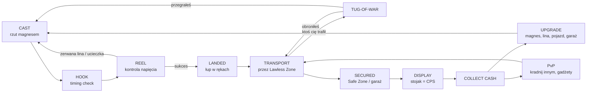
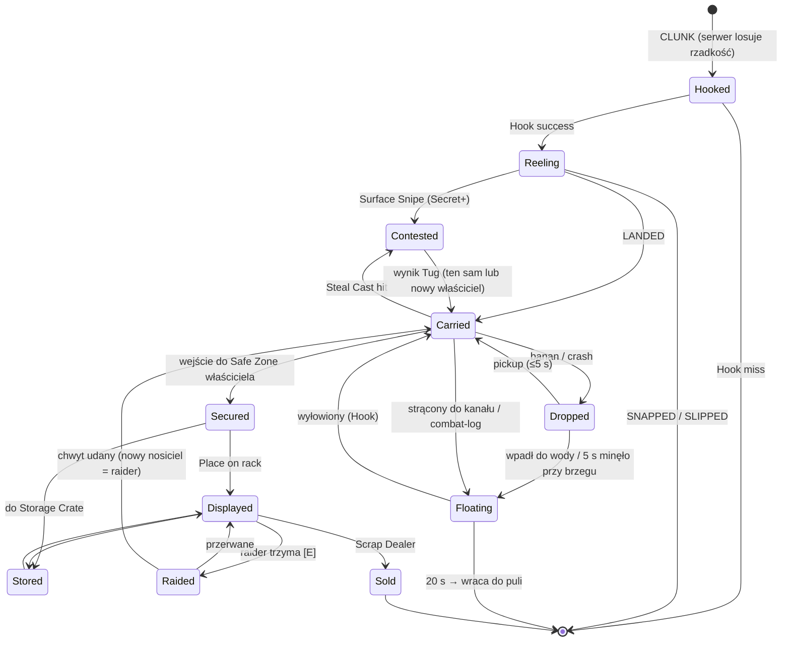

# Magnet & Steal a Brainrot — Game Design Document

| | |
|---|---|
| **Platforma** | Roblox (PC, Mobile, Console, Tablet) |
| **Gatunek** | Fishing Simulator × Tycoon × PvP Steal |
| **Język gry** | **English** (cały UI, nazwy przedmiotów, komunikaty). Dokument: polski. |
| **Wersja GDD** | 1.0 (MVP + Live Ops 1. miesiąca) |
| **Rozmiar serwera** | 8 graczy (8 garaży na mapę) |
| **Docelowa sesja** | 25–35 min; D1 ≥ 35%, D7 ≥ 12%, konwersja płatna ≥ 3% |
| **Grupa docelowa** | 9–16 lat, ~65% Mobile — wszystkie minigry muszą działać na jeden kciuk |

> **Konwencja:** wszystko, co jest zapisane `w ten sposób` lub w cudzysłowie po angielsku, to **dokładny tekst w grze** (UI string / nazwa). Waluta w grze: **Cash ($)**. Robux oznaczam **R$**.

---

## 0. High Concept i Filary

**Elevator pitch (EN, do opisu gry):**
> *"Throw a neodymium magnet into the filthiest canal in Ohio. Pull out cursed brainrot junk. Drag it home before someone yanks it out of your hands."*

### Filary designu

| # | Filar | Co to znaczy w praktyce |
|---|---|---|
| 1 | **"One more cast"** | Pojedynczy rzut + wyłowienie trwa 12–25 s. Zawsze jest szansa na Secret. Napięcie budowane jest *przed* ujawnieniem rzadkości (kolor bąbelków). |
| 2 | **Risk vs Reward w przestrzeni** | Im głębsze (rzadsze) łowisko, tym dłuższa droga do bazy przez **Lawless Zone**. Najlepszy łup = najdłuższy, najbardziej niebezpieczny powrót. |
| 3 | **Każdy rzadki drop to wydarzenie serwerowe** | Secret+ uruchamia `THIEF ALERT` — cały serwer wie, kto niesie skarb, i rusza w pościg. To jest generator klipów. |
| 4 | **Skill > Gear (do pewnego stopnia)** | Lepszy sprzęt daje przewagę, ale perfekcyjny timing pokonuje ~1,5× różnicę w sprzęcie. Nowy gracz ma realną szansę obronić łup. |
| 5 | **Fizyczna komedia** | Ragdolle, skórki od banana, liny, które się plączą, gracze wciągani do kanału przez zbyt ciężki łup. |

### Mapa: "The Rust Canal"

```
   [G1]   [G2]   [G3]   [G4]          <- Garaże (Safe Zone) — strona północna
 ===== STREET (Lawless) ==============
  Shallow Bank   |  Bridge Drop  |      <- Łowiska płytkie (blisko baz)
 ~~~~~~~~~~~~~ THE RUST CANAL ~~~~~~~~~~~~~
  Lock Gate  ~~ [Abyss Pipe island] ~~  Sewer Outflow
 ~~~~~~~~~~~~~~~~~~~~~~~~~~~~~~~~~~~~~~~~~~~~
 ===== STREET (Lawless) ==============
   [G5]   [G6]   [G7]   [G8]          <- Garaże (Safe Zone) — strona południowa
```

| Łowisko (Fishing Spot) | Wymagana głębokość liny | Mnożnik szczęścia strefy | Odległość od najbliższego garażu | Czas powrotu pieszo (16 studs/s) |
|---|---|---|---|---|
| `Shallow Bank` | 0–5 m | ×1.00 | 40 studs | ~3 s |
| `Bridge Drop` | 5–12 m | ×1.25 | 80 studs | ~5 s |
| `Lock Gate` | 12–25 m | ×1.60 | 140 studs | ~9 s |
| `Sewer Outflow` | 25–35 m | ×2.20 | 200 studs | ~13 s |
| `Abyss Pipe` (wyspa pośrodku, dojście kładką) | 35 m+ | ×3.00 | 260 studs | ~17 s (+ kładka bez barierek = banany!) |

> Czas powrotu rośnie dodatkowo przez spowolnienie od ciężaru łupu (patrz 4.3). Realnie powrót z `Abyss Pipe` z Mythicem pieszo to ~30 s w Lawless Zone — to celowe.

---

## 1. Core Loop & Player Journey

### 1.1 Główna pętla (Core Loop)



| Krok | Czas (typowo) | Co robi gracz | Emocja / hak |
|---|---|---|---|
| 1. **Cast** | 1–2 s | Przytrzymuje i puszcza w strefie `PERFECT` paska mocy | Mikro-skill, natychmiastowy feedback |
| 2. **Sink & Scan** | 2–6 s | Czeka; magnes opada, wykrywacz "pika" coraz szybciej | Antycypacja |
| 3. **Hook** | 0,4 s | Klik w odpowiednim momencie (pierścień QTE) | Refleks |
| 4. **Reel** | 5–25 s | Utrzymuje igłę napięcia w zielonej strefie, reaguje na `SNAG!` | Napięcie, kolor bąbelków zdradza rzadkość |
| 5. **Landed** | 1–3 s | Reveal rzadkości, VFX/SFX, ew. `THIEF ALERT` | Dopamina / panika |
| 6. **Transport** | 3–30 s | Biegnie do garażu, unika magnesów, rzuca banany | Ucieczka, PvP |
| 7. **Secure & Display** | 2 s | Wchodzi do Safe Zone → `SECURED!` → kładzie na stojak | Ulga, licznik `+$X/s` |
| 8. **Upgrade** | 10–30 s | Zbiera cash z `Cash Pad`, kupuje ulepszenia | Progres |
| 9. **PvP** | dowolnie | Poluje na innych niosących łup / robi rajd na otwarty garaż | Rywalizacja, zemsta |

**Pętle wtórne:**
- **Pętla obrony bazy:** co 60 s trzeba wrócić i ponownie zamknąć `Shutter Lock`, inaczej garaż jest otwarty na rajd → wymusza decyzję „łowię daleko vs pilnuję bazy”.
- **Pętla kolekcji:** `Index` (album wszystkich Brainrotów × mutacje) z nagrodami za ukończenie stron.
- **Pętla meta:** `Rebirth` resetuje postęp za stały mnożnik cash i luck.

### 1.2 Player Journey (fazy)

| Faza | Czas gry | Sprzęt | Łowiska | Cele | Główne PvP |
|---|---|---|---|---|---|
| **Rookie** | 0–30 min | Magnesy 1–4, Twine → Nylon | Shallow, Bridge | Zapełnić 6–10 slotów, pierwszy Epic | Obrona przed kradzieżą, banany |
| **Scrapper** | 30 min – 5 h | Magnesy 4–7, Steel/Kevlar | Lock Gate, Sewer | Pierwszy Secret, Garaż Lv4–5, Rebirth 1–2 | Rajdy garaży, polowanie na `THIEF ALERT` |
| **Canal Legend** | 5 h+ | Magnesy 8–10, Titan/Graphene, Tow Truck | Sewer, Abyss | Cursed/Mythic, ukończony Index, Rebirth 5+ | Leaderboard `Most Wanted`, eventy |

### 1.3 Onboarding — pierwsze 5 minut

Zasada: **pierwsze 5 minut jest częściowo oskryptowane** (gwarantowane dropy i NPC-złodziej), gracz ma `New Player Shield` (10 min, nie można mu nic ukraść ani zrajdować garażu).

| Czas | Wydarzenie | Tekst UI (EN) | Cel designu |
|---|---|---|---|
| 0:00–0:10 | Spawn w swoim `Cardboard Shed`. 4-sekundowy przerywnik: NPC wyrywa komuś świecący łup magnesem i ucieka. | `Welcome to the Rust Canal!` | Pokazać fantazję *kradzieży* zanim gracz cokolwiek zrobi |
| 0:10–0:25 | Strzałka na ziemi prowadzi do `Shallow Bank`. W hotbarze `Fridge Magnet`. | `Go to the canal!` | Ruch i orientacja |
| 0:25–0:40 | Pierwszy rzut — pasek mocy spowolniony 50%, strefa `PERFECT` podświetlona. | `Hold to charge... RELEASE!` | Nauka castu, gwarantowany `PERFECT!` |
| 0:40–1:10 | Pierwsze łowienie — **gwarantowany Rare** `Rizz Radiator`. Thrash wyłączony, tooltipy. | `HOOK IT!` → `Keep the needle in the GREEN!` | Nauka hook + reel bez ryzyka porażki |
| 1:10–1:40 | Transport do garażu, położenie na stojaku. Licznik `+$8/s` z dźwiękiem kasy. | `Place it on a rack to earn Cash!` | Zrozumienie CPS |
| 1:40–2:30 | Łowienie #2 (Common, normalne) i #3 — **gwarantowany Epic** `Ohio Toaster` + pierwszy `SNAG!` QTE. Lokalny mini-alert `EPIC!`. | `SNAG! Press [E] on the mark!` | Pierwszy duży „wow”, nauka snaga |
| 2:30–3:15 | NPC **„Sneaky Steve”** trafia gracza magnesem w Lawless Zone → oskryptowany Tug-of-War (Steve gra na 50% mocy, gracz zawsze wygrywa). Nagroda: 3× `Banana Peel`. | `A THIEF! Tap on the beat to pull back!` → `DEFENDED!` | Nauka obrony, pierwszy gadżet |
| 3:15–4:00 | Zbieranie cash z `Cash Pad` (+ prezent `$500`) → Shop → zakup `Ferrite Puck` ($500). | `You can afford an upgrade!` | Pierwszy zakup przed 4. minutą |
| 4:00–4:40 | Quest: Steve niesie Rare po ulicy — gracz używa `Steal Cast` [Q] i wygrywa. | `Steal it back! Press [Q] to throw your magnet!` | Nauka ataku, smak zemsty |
| 4:40–5:00 | Tutorial `Shutter Lock`, odblokowanie Daily Quests, pokazanie kolejnego celu `Tin Garage — $2,500` i licznika tarczy. | `Lock your garage or thieves will raid it!` · `New Player Shield: 05:00` | Ustawienie celów na następne 10 min |

**Lejek onboardingu (cele KPI):** pierwszy cast 97% → pierwszy item na stojaku 88% → wygrany Tug-of-War 80% → pierwszy zakup 72% → ukończony tutorial 65%.

---

## 2. Mechanika Łowienia (Magnet Fishing Minigame)

### 2.1 Fazy minigry

```
CAST (1–2 s) → SINK & SCAN (2–6 s) → HOOK (okno 0,35 s) → REEL (5–25 s, z SNAG QTE) → LANDED
```

#### Faza A — CAST (siła rzutu)
- Przytrzymanie LPM / palca → pasek mocy oscyluje 0→100→0 (okres 1,2 s).
- Strefy paska: `WEAK` 0–40% · `GOOD` 40–85% · `PERFECT` 85–95% · `OVERTHROW` 95–100%.

| Wynik | Efekt |
|---|---|
| `WEAK` | Głębokość × 0,7 (może nie dosięgnąć głębszej puli łowiska → mnożnik strefy spada o 1 próg) |
| `GOOD` | Normalnie |
| `PERFECT` | +10% Luck na ten połów, +2 m głębokości, czas Sink −1 s |
| `OVERTHROW` | Magnes ląduje za daleko — 15% szansy na zaplątanie w śmieci (Sink +2 s), poza tym jak `GOOD` |

#### Faza B — SINK & SCAN (oczekiwanie)
- Czas oczekiwania: `rand(2.0, 6.0) s × MagnetSinkMult` (magnesy wyższe = szybciej, min. 1,5 s).
- Wykrywacz metalu: dźwięk „pik” przyspiesza; ostatnie 0,5 s → mocne **CLUNK**, szarpnięcie liny, ikona `!`.
- **Rzadkość jest losowana po stronie serwera w momencie CLUNK** (patrz sekcja 6), ale *nie jest ujawniana*.

#### Faza C — HOOK (wyczucie momentu)
- Pierścień zwężający się do środka; gracz klika, gdy pierścień pokryje znacznik.
- Okno bazowe: **0,35 s** (+ bonus magnesu, patrz 2.2). Strefa `PERFECT HOOK`: środkowe **0,12 s**.

| Wynik | Efekt |
|---|---|
| `PERFECT HOOK!` | Start napięcia w środku zielonej strefy, +5% wartości łupu (size roll +0,05), pierwszy thrash opóźniony o 1,5 s |
| `HOOKED!` | Start napięcia 20% (poniżej strefy) — gracz musi „dociągnąć” |
| `MISSED...` | Łup ucieka. Cooldown magnesu pełny. Common/Rare: brak kary; Epic+: bąbelki pokazują kolor („to był Secret...”) — **celowy ból = retencja** |

#### Faza D — REEL (kontrola napięcia liny) — główny skill-check

UI: pionowy **Tension Bar** (0–100) z igłą. Na pasku:

```
100 ┃ ███  RED ZONE (85–100)  → lina traci HP
    ┃
    ┃ ▓▓▓  SWEET SPOT (rozmiar = Catch Zone magnesu, dryfuje)  → postęp rośnie
    ┃
  0 ┃ ░░░  SLACK (poniżej strefy) → postęp spada, po 2 s łup się zsuwa
```

**Sterowanie:** przytrzymanie = zwijanie (napięcie rośnie), puszczenie = luzowanie (napięcie spada). Jeden przycisk — idealne na mobile.

| Parametr | Wartość |
|---|---|
| Wzrost napięcia przy trzymaniu | +55 /s |
| Spadek napięcia po puszczeniu | −45 /s |
| Postęp w Sweet Spot | `12 %/s × ReelSpeed(liny) × PullFactor` |
| `PullFactor` | `sqrt(clamp(MagnetPull / ItemWeight, 0.5, 2.0))` → zakres 0,71–1,41 |
| Utrata postępu poza Sweet Spot | −8 %/s |
| Red Zone (85–100) | Lina traci **40 HP/s** po upływie `Snap Grace` liny |
| Lina HP = 0 | `LINE SNAPPED!` — łup przepada, cooldown + 2 s |
| Slack > 2,0 s nieprzerwanie | `IT SLIPPED AWAY...` |
| Postęp 100% | `LANDED!` |

**Thrash (szarpnięcia łupu)** — losowe skoki napięcia, generowane z serwerowego seeda:
`Amplituda = BazowaAmplituda[rzadkość] × max(1, ItemWeight / MagnetPull)` → za słaby magnes na ciężki łup = brutalne szarpnięcia.

| Rzadkość | Thrash / s | Bazowa amplituda | Dryf Sweet Spot | SNAG QTE | Specjalne | Typowy czas Reel |
|---|---|---|---|---|---|---|
| Common | 0,3 | +10 | 0 | 0 | — | 5–7 s |
| Rare | 0,5 | +15 | 5 %/s | 0–1 | — | 7–9 s |
| Epic | 0,7 | +20 | 10 %/s | 1 | — | 9–12 s |
| Secret | 0,9 | +25 | 15 %/s | 2 | Ziemia drży (camera shake), złote bąbelki | 12–16 s |
| Cursed | 1,1 | +30 | 20 %/s | 2 | **Curse Fight:** na 3 s sterowanie odwrócone (trzymanie = luzowanie), ekran czerwono-czarny | 15–20 s |
| Mythic | 1,3 | +35 | 25 %/s | 3 | Muzyka cichnie, tęczowy wir w wodzie, Sweet Spot pulsuje (zmienia rozmiar ±20%) | 18–25 s |

**SNAG QTE** (łup zahacza o wózek sklepowy / oponę): igła obraca się po łuku, gracz klika `[E]` / przycisk, gdy jest na znaczniku.
- Okno: **0,25 s** · Sukces: +10% postępu, `NICE!` · Porażka: skok napięcia +35 (często wpada w Red Zone).

**Wskazówki rzadkości w trakcie Reel (kluczowe dla emocji i klipów):**

| Rzadkość | Bąbelki | Dźwięk |
|---|---|---|
| Common | brak | normalny |
| Rare | niebieskie | — |
| Epic | fioletowe | niski pomruk |
| Secret | złote + snop światła z wody | rosnący chór |
| Cursed | czerwono-czarne, woda „wrze” | szepty, zgaszenie latarni w promieniu 30 studs |
| Mythic | tęczowy wir | muzyka całkowicie cichnie, słychać tylko bicie serca |
| *Bait & Switch* (1% Commonów) | **złote** bąbelki, ale wychodzi `Golden Toilet Seat` (Common) | `bruh.mp3`-style SFX (własny dźwięk) |

**Docelowe współczynniki sukcesu (do testów balansu):**

| Profil gracza | Common | Rare | Epic | Secret | Cursed | Mythic |
|---|---|---|---|---|---|---|
| Nowy gracz, `Fridge Magnet` + `Twine` | 92% | 78% | 55% | 30% | 10% | <5% |
| Średni, `Neodymium N52` + `Steel Cable` | 99% | 95% | 85% | 65% | 45% | 30% |
| Ekspert, `Sigma Singularity` + `Graphene Thread` | 100% | 99% | 97% | 88% | 72% | 60% |

**Dostępność:** na Mobile Sweet Spot +4 p.p., okno Hook +40 ms (kompensacja dotyku); tryb `Colorblind` (wzory zamiast kolorów bąbelków).

#### Faza E — Cooldown
Po każdym połowie (udanym lub nie) magnes ma `Cooldown` (tabela 2.2). Nie można łowić z pełnym plecakiem (`Your hands are full!`).

### 2.2 Statystyki Magnesów

| # | Magnet | Cena | Pull (kg) | Range (studs) | Cooldown (s) | Catch Zone (% paska) | Hook window bonus | Luck | Steal Power | Wymóg |
|---|---|---|---|---|---|---|---|---|---|---|
| 1 | `Fridge Magnet` | Free | 10 | 25 | 6,0 | 22% | +0 ms | +0,00 | 1,00 | — |
| 2 | `Ferrite Puck` | $500 | 20 | 30 | 5,5 | 24% | +10 ms | +0,05 | 1,10 | — |
| 3 | `Horseshoe Classic` | $3,000 | 35 | 35 | 5,0 | 25% | +20 ms | +0,10 | 1,20 | — |
| 4 | `Neodymium N35` | $15,000 | 60 | 40 | 4,5 | 27% | +30 ms | +0,15 | 1,35 | — |
| 5 | `Neodymium N52` | $75,000 | 100 | 45 | 4,0 | 28% | +40 ms | +0,25 | 1,50 | — |
| 6 | `Double-Sided Beast` | $300,000 | 150 | 50 | 3,5 | 30% | +50 ms | +0,35 | 1,70 | — |
| 7 | `Electro-Mag 3000` | $1.2M | 220 | 55 | 3,2 | 31% | +60 ms | +0,50 | 1,90 | Rebirth 1 |
| 8 | `Scrapyard Crane Disc` | $6M | 320 | 60 | 3,0 | 33% | +70 ms | +0,70 | 2,20 | Rebirth 2 |
| 9 | `Sigma Singularity` | $50M | 450 | 65 | 2,7 | 35% | +80 ms | +1,00 | 2,50 | Rebirth 4 |
| 10 | `Black Hole Magnet` | $250M **lub** event | 650 | 75 | 2,5 | 38% | +100 ms | +1,50 | 3,00 | Rebirth 6 |

**Definicje statystyk:**
- **Pull (kg)** — porównywany z wagą łupu: wpływa na `PullFactor` (szybkość Reel) i na amplitudę Thrash. Także na siłę w Tug-of-War przy ciężkich łupach.
- **Range (studs)** — maks. odległość castu przy `PERFECT` (wpływa na to, czy dosięgniesz głębszej puli z brzegu) oraz zasięg `Steal Cast` = **Range × 0,6** (15–45 studs).
- **Cooldown** — czas po połowie do kolejnego castu. `Steal Cast` ma osobny cooldown (patrz 3.1).
- **Catch Zone** — wysokość Sweet Spot na Tension Bar.
- **Steal Power** — bazowa siła w Tug-of-War.

### 2.3 Liny (Rope)

| Rope | Cena | Line HP | Max depth | Reel Speed | Snap Grace | Tug Grip |
|---|---|---|---|---|---|---|
| `Twine` | Free | 100 | 5 m | ×1,00 | 0,30 s | ×1,00 |
| `Paracord` | $1,000 | 130 | 8 m | ×1,10 | 0,40 s | ×1,05 |
| `Nylon Braid` | $8,000 | 170 | 12 m | ×1,20 | 0,50 s | ×1,10 |
| `Steel Cable` | $60,000 | 220 | 18 m | ×1,30 | 0,60 s | ×1,15 |
| `Kevlar Line` | $400,000 | 290 | 25 m | ×1,45 | 0,70 s | ×1,25 |
| `Titan Chain` | $3M | 380 | 35 m | ×1,60 | 0,85 s | ×1,35 |
| `Graphene Thread` | $20M | 500 | 50 m | ×1,80 | 1,00 s | ×1,50 |

> **Max depth liny jest twardą bramką do łowisk** (np. `Abyss Pipe` wymaga `Titan Chain`). Wyjątek: event `Low Tide` (sekcja 4.5) obniża wymagania o 1 próg.

### 2.4 Tabela Rzadkości

| Rzadkość | Kolor | Bazowa szansa | 1 na X | Mnożnik wartości | Bazowy CPS przedmiotu | Waga (kg) | Bramka łowiska | Luck sensitivity `f` |
|---|---|---|---|---|---|---|---|---|
| **Common** | szary | 68,50% | 1,5 | ×1 | $1–5/s | 2–8 | wszędzie | 0,0 |
| **Rare** | niebieski | 24,00% | 4,2 | ×5 | $5–25/s | 6–15 | wszędzie | 0,5 |
| **Epic** | fioletowy | 6,50% | 15 | ×25 | $25–125/s | 12–30 | wszędzie | 0,8 |
| **Secret** | złoty | 0,90% | 111 | ×150 | $150–750/s | 25–60 | wszędzie | 1,0 |
| **Cursed** | czerwono-czarny | 0,09% | 1 111 | ×1 000 | $1,000–5,000/s | 40–90 | od `Lock Gate` (12 m+) | 1,0 |
| **Mythic** | tęczowy | 0,01% | 10 000 | ×7 500 | $7,500–37,500/s | 80–200 | wszędzie, ale ×0,2 wagi poniżej 35 m | 1,0 |

#### Formuła szczęścia (Luck)

```
L_raw   = (1 + Σ bonusy addytywne) × ZoneMult × Π mnożniki (boostery, server luck)
L       = min(L_raw, 25)                                  -- twardy cap
w'_r    = w_r × (1 + (L − 1) × f_r)                       -- Common ma f=0, więc maleje tylko względnie
P(r)    = w'_r / Σ w'
```

**Bonusy addytywne:** magnes (+0 … +1,5), `VIP` +0,25, Friends on server +0,10/przyjaciel (max +0,40), dołączenie do grupy +0,10, Rebirth +0,10/poziom, `PERFECT` cast +0,10.
**Mnożniki:** strefa (×1,0–×3,0), `Super Luck` gamepass ×1,5, Luck Booster ×2/×3, Server Luck ×2, eventy.

**Szanse przy różnych poziomach Luck (wyliczone z formuły):**

| L | Common | Rare | Epic | Secret | Cursed | Mythic |
|---|---|---|---|---|---|---|
| 1 | 68,5% | 24,0% | 6,50% (1/15) | 0,90% (1/111) | 0,090% (1/1 111) | 0,010% (1/10 000) |
| 2 | 58,0% | 30,5% | 9,90% (1/10) | 1,52% (1/66) | 0,152% (1/657) | 0,017% (1/5 910) |
| 3 | 50,2% | 35,2% | 12,4% (1/8) | 1,98% (1/51) | 0,198% (1/505) | 0,022% (1/4 547) |
| 5 | 39,6% | 41,7% | 15,8% (1/6) | 2,60% (1/38) | 0,260% (1/384) | 0,029% (1/3 456) |
| 10 | 26,0% | 50,0% | 20,2% (1/5) | 3,41% (1/29) | 0,341% (1/293) | 0,038% (1/2 638) |
| 25 (cap) | 12,8% | 58,1% | 24,5% (1/4) | 4,19% (1/24) | 0,419% (1/239) | 0,047% (1/2 147) |

> Formuła ma malejące zwroty dla Secret+ — nawet przy maksymalnym Luck Mythic zostaje „wydarzeniem” (1/2 147). Dzięki temu boostery dobrze się sprzedają, a ekonomia się nie psuje.

**Ochrona przed pechem (Pity):**
- `Epic Pity`: 40 połowów z rzędu bez Epic+ → następny połów ≥ Epic.
- `Secret Soft Pity`: od 250. połowu bez Secret+ każdy kolejny daje +1% L (addytywnie), gwarancja Secret na 400.
- Mythic i Cursed — brak pity (rzadkość ma być prawdziwa).
- Liczniki pity widoczne w `Index` → `Bad Luck Meter` (zachęca do „jeszcze jednego”).

#### Mutacje (losowane niezależnie od rzadkości)

| Mutacja | Szansa | Mnożnik CPS | Wizual | Dostępność |
|---|---|---|---|---|
| `Normal` | 90,00% | ×1 | — | zawsze |
| `Gold` | 6,00% | ×2 | złota tekstura | zawsze |
| `Diamond` | 2,50% | ×4 | kryształowa + błyski | zawsze |
| `Radioactive` | 1,00% | ×6 | zielona poświata, cząsteczki | zawsze (×3 w `Toxic Spill`) |
| `Rainbow` | 0,40% | ×10 | animowany gradient | zawsze |
| `Electrified` | 0,09% | ×20 | iskry, łuk elektryczny | tylko `Thunderstorm` |
| `Galaxy` | 0,01% | ×50 | kosmiczny shader | tylko `Meteor Shower` |

**Size roll:** każdy łup ma `SizeMult` 0,80–1,50 (rozkład trójkątny, mod 1,0), wpływa na wagę i CPS. `PERFECT HOOK` dodaje +0,05.

#### Przykładowe Brainroty (Index v1 — oryginalne, parodystyczne nazwy, bez cudzego IP)

> Fabularnie magnes łapie tylko metal — każdy Brainrot to zardzewiały, „ożywiony” złom z twarzą.

| Rzadkość | Name (EN) | Base CPS | Waga bazowa | Gag / zachowanie na stojaku |
|---|---|---|---|---|
| Common | `Rusty Bolt Bro` | $1 | 2 kg | Kręci się i mruga |
| Common | `Bent Fork Goblin` | $2 | 3 kg | Drapie się po głowie |
| Common | `Canny McCanface` | $3 | 4 kg | Bekanie co 10 s |
| Common | `Soggy Shopping Cart` | $4 | 8 kg | Kółko się kręci samo |
| Common | `Golden Toilet Seat` | $5 | 5 kg | Przynęta Bait & Switch |
| Rare | `Rizz Radiator` | $8 | 9 kg | Puszcza oczko do graczy w pobliżu |
| Rare | `Skateboard Sigma` | $12 | 6 kg | Robi kickflip |
| Rare | `Crowbar Chad` | $18 | 7 kg | Napina „mięśnie” |
| Rare | `Mailbox Mewing` | $25 | 14 kg | Klasyczny „mewing” z dźwiękiem |
| Epic | `Ohio Toaster` | $40 | 12 kg | Wystrzeliwuje tosty |
| Epic | `Bombardilo Bathtub` | $65 | 30 kg | „Lata” 1 stud nad stojakiem |
| Epic | `Lawnmower Lord` | $90 | 25 kg | Odpala silnik, gdy ktoś podejdzie |
| Epic | `Scooterini Scrapolini` | $125 | 18 kg | Jeździ w kółko po półce |
| Secret | `Cappuccino Anchorino` | $300 | 45 kg | Paruje kawą, śpiewa po włosku (oryginalny jingle) |
| Secret | `Trolley Trollolero` | $450 | 50 kg | Tańczy, gdy właściciel jest w bazie |
| Secret | `The Grand Rustalini` | $750 | 60 kg | Dyryguje orkiestrą innych Brainrotów |
| Cursed | `Haunted Cash Register` | $2,000 | 40 kg | Otwiera szufladę i krzyczy `NO REFUNDS` |
| Cursed | `Possessed Vending Machine` | $3,500 | 75 kg | Wypluwa puszki w raiderów |
| Cursed | `The Drowned Dumpster` | $5,000 | 90 kg | Kapie z niego czarna woda, migające światła |
| Mythic | `Golden Neodymium Core` | $15,000 | 80 kg | Przyciąga drobne Commony z sąsiednich slotów (kosmetycznie) |
| Mythic | `Sunken Satellite` | $25,000 | 140 kg | Wyświetla nad garażem hologram nicku właściciela |
| Mythic | `THE CANAL KING` | $37,500 | 200 kg | Korona, peleryna, własny theme music w promieniu 60 studs |

**Cechy specjalne Cursed (high-risk, high-reward):**
- W transporcie: nosiciel jest `MARKED` (widoczny przez ściany dla wszystkich, czerwony beam nad głową), −15% prędkości.
- Na stojaku: dym widoczny na minimapie wszystkich graczy → garaż staje się celem rajdów.
- Wyłowienie wymaga wygrania `Curse Fight` w fazie Reel.

---

## 3. Mechanika PvP i Kradzieży (Steal / Hook System)

### 3.1 Steal Cast (atak)

| Parametr | Wartość |
|---|---|
| Klawisz | `[Q]` (PC) / przycisk `STEAL` (Mobile) / `RB` (Gamepad) |
| Warunki | Atakujący i cel w **Lawless Zone**; atakujący ma wolne miejsce w plecaku; cel niesie ≥1 łup; cel bez `New Player Shield` |
| Zasięg | `MagnetRange × 0,6` → 15–45 studs |
| Pocisk | Magnes leci po łuku, 120 studs/s, hitbox kula r = 2,5 studs (serwerowy Spherecast) |
| Aim assist | Mobile: miękki lock-on na najbliższego nosiciela w stożku 20°; PC: 10° |
| Cooldown po pudle | 8 s |
| Cooldown po przegranej Tug | 15 s + `Stunned` 1,5 s |
| Cooldown per para (ten sam atakujący → ta sama ofiara) | 45 s |
| Atakujący sam coś niesie | Dozwolone, ale Steal Power ×0,8 |

**Trafienie → natychmiast startuje Tug-of-War.** Między graczami pojawia się napięta lina (Beam), łup unosi się w połowie drogi.

### 3.2 Tug-of-War (przeciąganie liny)

**Mechanika rytmiczna (anty-autoclicker):** w UI pojawia się pulsujący pierścień **beat** co `0,45 s ± 0,10 s` (jitter z seeda — nie da się zautomatyzować klikaniem na stały interwał). Obaj gracze klikają w rytm.

| Ocena | Okno względem beatu | Accuracy |
|---|---|---|
| `PERFECT` | ±60 ms | 1,0 |
| `GOOD` | ±140 ms | 0,6 |
| `MISS` / brak / podwójne kliknięcie | — | 0,0 |

**Siła na beat:**
```
F_attacker = StealPower × TugGrip(liny) × Accuracy × clamp(MagnetPull / ItemWeight, 0.5, 1.2)
             × (1.25 jeśli Revenge) × (0.8 jeśli sam coś niesie) × (0.6 jeśli Rust Spray na nim)
F_defender = StealPower × TugGrip × Accuracy × 1.15 (Defender Bonus)
             × CarrierStealResist(pojazd/plecak) × (1.30 Underdog Bonus, jeśli jego CPS < 20% CPS atakującego)
             × (1.30 Home Bonus, jeśli broni w swoim garażu przed raiderem)
```

**Pozycja liny:** `P ∈ [−100, +100]`, start `P = 0`. `+100` = wygrywa atakujący, `−100` = wygrywa obrońca.
```
ΔP (na beat) = 30 × (F_a − F_d) / max(F_a, F_d, 0.01)
```

| Scenariusz | Przebieg |
|---|---|
| Równy sprzęt, atakujący `PERFECT`, obrońca `GOOD` | ΔP ≈ +9,3/beat → wygrana ataku po ~11 beatach (~5 s) |
| Równy sprzęt, obaj `PERFECT` | Obrońca wygrywa (bonus 1,15) — ΔP ≈ −3,9/beat |
| Obrońca AFK | ΔP = +30/beat → strata po 4 beatach (~1,8 s) |
| Atakujący 2,5 SP vs obrońca 1,0 SP, obaj `PERFECT` | ΔP ≈ +16/beat → ~3 s |
| Atakujący 1,7 SP `GOOD` vs obrońca 1,0 SP `PERFECT` | Obrońca wygrywa → **skill pokonuje ~1,5× różnicę sprzętu** |

- **Timeout:** 6,0 s. Po czasie wygrywa strona, po której jest lina; `P = 0` → obrońca.
- **Ruch:** obrońca może iść z prędkością ×0,3 (może się „doczołgać” do Safe Zone — **wejście do Safe Zone w trakcie Tug = natychmiastowa wygrana obrońcy** → epickie klipy). Atakujący jest zakotwiczony.
- **Trzecia osoba:** do 3 atakujących na jeden łup. Siły atakujących sumują się, ale łup trafia do tego, kto zadał najwięcej `F` łącznie. Sojusznik obrońcy (przyjaciel / party) może rzucić magnes na *łup* i dodać swoją siłę po stronie obrony.

**Wynik:**

| Wynik | Efekt |
|---|---|
| Atakujący wygrywa | Łup leci po łuku do atakującego (0,6 s), banner `STOLEN!` dla obu (różne kolory). Ofiara dostaje `REVENGE` na 60 s: +25% siły przeciw temu złodziejowi, brak cooldownu na niego, strzałka na HUD. |
| Obrońca wygrywa | `DEFENDED!`, atakujący `Stunned` 1,5 s + cooldown 15 s. Obrońca ma 3 s immunitetu. |
| Kradziony jest… | Zawsze **najcenniejszy** łup z plecaka (leży na górze stosu i świeci — czytelność). Jedna wygrana = jeden przedmiot. |

**Ochrona przed nadużyciami:**
- `New Player Shield`: pierwsze 10 min lub do pierwszego Secret (co pierwsze).
- Po utracie łupu: 20 s immunitetu (`PROTECTED` nad głową).
- `Combat Tag`: trafiony / w Tug w ostatnich 10 s → wyjście z gry = łup spada do wody jako `Floating Loot` (anti combat-logging). Wyjście w trakcie Tug = automatyczna wygrana atakującego.

### 3.3 Lawless Zone vs Safe Zone

| Strefa | Gdzie | Kradzież z rąk (Steal Cast) | Gadżety | Rajd na wystawę | Inne |
|---|---|---|---|---|---|
| **Safe Zone — Garage** | Wnętrze własnego garażu | ❌ (dla właściciela) | Tylko obronne | ✅ jeśli `Shutter` otwarty | Raider w cudzym garażu **jest** w Lawless dla właściciela |
| **Safe Zone — Driveway** | 12 studs przed bramą | ❌ | ❌ | — | Bufor anty-spawn-camping; wejście z łupem = `SECURED!` |
| **Safe Zone — Spawn / Shop** | Plac sklepu i NPC | ❌ | ❌ | — | Brak PvP, brak noszenia łupu (auto-schowanie) |
| **Lawless Zone — Street** | Ulice, mosty, kładki | ✅ | ✅ wszystkie | — | Czerwony tint ekranu przy wejściu z łupem: `LAWLESS ZONE — Your loot can be stolen!` |
| **Lawless Zone — Docks** | Łowiska | ✅ (nosiciele) | ✅ | — | Łowiący **nie** może być okradziony z liny, ale może być strącony do wody bananem/miną → połów przerwany |
| **Surface Snipe** | Woda przy łowiącym | ✅ tylko Secret+ | — | — | W ostatnich 2 s fazy Reel (łup na powierzchni) inny gracz może rzucić Steal Cast w łup. Łowiący broni z bonusem ×1,30. Max dramat. |

**Rajd na garaż (Garage Heist):**

| Parametr | Wartość |
|---|---|
| `Shutter Lock` | Przycisk na ścianie w garażu; zamyka na **60 s** (`Laser Shutter` 90 s — $250k, `Titanium Shutter` 120 s — $5M). Ostrzeżenie 10 s przed otwarciem. |
| Kto może rajdować | Gracz bez `Shield`; cel ma ≥3 przedmioty na wystawie i jest online |
| Czas „chwytania” (hold `[E]`) | Common 1 s · Rare 1,5 s · Epic 2 s · Secret 3 s · Cursed 4 s · Mythic 5 s (przerwane przez obrażenie/gadżet) |
| Alarm | Właściciel dostaje `YOUR GARAGE IS BEING RAIDED!` + strzałkę, nawet jeśli łowi |
| Po udanym rajdzie | Garaż ma 90 s `Raid Immunity` |
| Obrona | Właściciel może zrobić Steal Cast na raidera w swoim garażu i na ulicy (Home Bonus ×1,30 w garażu) |

### 3.4 Przedmioty obronne i trollujące (Gadgets)

Gracz ma **3 sloty gadżetów** w hotbarze (+1 gamepass). Stack max 10 szt. Ceny w Cash; pakiety za R$ w sekcji 4.4.

| Gadget | Typ | Cena | Cooldown | Działanie | Kontra |
|---|---|---|---|---|---|
| `Banana Peel` | Troll | $2,500 / 3 szt. | 3 s | Kładziesz na ziemi (max 3 aktywne, 45 s). Kto wejdzie: ragdoll 1,5 s, **niesiony łup wypada 4 studs przed nim** i leży 5 s — pierwszy, kto podniesie, ten bierze | `Grip Boots` |
| `Oil Slick` | Troll / Area | $10,000 | 20 s | Plama r = 8 studs, 30 s; −60% przyczepności, poślizg; pojazdy robią spin-out | `Grip Boots` (−50%) |
| `EMP Grenade` | Obronny/ofensywny | $25,000 | 30 s | r = 10 studs: wyłącza magnesy na 4 s, **przerywa wszystkie Tug-of-War w zasięgu (wygrywa obrońca)** | `Faraday Cap` (−75% czasu) |
| `Magnet Shield` | Obronny | $15,000 | 40 s | Bańka 6 s: Steal Casty się odbijają (`DEFLECTED!`). Nie działa w trakcie Tug | `EMP` zdejmuje tarczę |
| `Decoy Brainrot` | Obronny / troll | $8,000 | 25 s | Upuszczasz fałszywy świecący łup (losowa „rzadkość” na wierzchu). Kto go ukradnie: konfetti, `GET TROLLED!`, stun 2 s | Inspekcja z bliska (lekko inny shimmer) |
| `Smoke Bomb` | Obronny | $6,000 | 20 s | Chmura r = 12 studs, 5 s: ukrywa nick i rzadkość nosiciela, lock-on niemożliwy | — |
| `Rust Spray` | Ofensywny | $12,000 | 25 s | Stożek 10 studs: Steal Power celu ×0,6 na 8 s (także w obronie) | `Magnet Shield` |
| `Speed Soda` | Mobilność | $3,000 | 15 s | +35% prędkości na 6 s; niedostępne w Tug | `Oil Slick` |
| `Repulsor Mine` | Troll | $30,000 | 35 s | Ukryta mina, knockback 25 studs (często do kanału). Łup nie wypada, ale wpadnięcie do wody = `Floating Loot` | Mina widoczna z 6 studs |
| `Reverse Polarity Card` | Kontra (rzadki, z Crate/R$) | R$ / Crate | 90 s | Aktywuj ≤ 1 s po trafieniu Steal Castem: Tug startuje od `P = −60` (na twoją korzyść) i atakujący stunned 1 s | Czysty mind-game |
| `Grip Boots` | Pasywny | $50,000 | — | Odporność na banany, −50% efektu oleju | — |
| `Faraday Cap` | Pasywny | $80,000 | — | −75% czasu EMP na tobie | — |
| `Tripwire Alarm` | Baza | $20,000 | — | Raider w garażu: alarm + spowolnienie 3 s | `Smoke Bomb` |

**Zasada `Floating Loot`:** łup wpadający do kanału (strącenie, combat-log, upuszczenie przy brzegu) unosi się 20 s na wodzie z beamem w kolorze rzadkości — każdy może go wyłowić *jednym* rzutem bez minigry Reel (tylko Hook). Potem tonie i wraca do puli łowiska. → chaotyczne „wyścigi rzutów”, świetne na klipy.

---

## 4. Ekonomia, Tycoon i System Bazy

### 4.1 Wystawa i pasywny dochód (CPS)

Każdy slot w garażu to **stojak**. Położony Brainrot generuje Cash co sekundę do `Cash Pad` przy wejściu (fizyczne zbieranie — gracz musi wrócić do bazy, co napędza pętlę obrony).

```
CPS_item  = BaseCPS × SizeMult × MutationMult × RackMult
CPS_total = Σ CPS_item × (1 + 0.5 × RebirthLevel) × (2 jeśli 2x Cash) × (1.1 jeśli VIP) × EventMult
```

| Rack tier (per slot) | Mnożnik | Koszt | Wygląd |
|---|---|---|---|
| `Wooden Pallet` | ×1,00 | Free | Paleta |
| `Metal Shelf` | ×1,10 | $5,000 | Regał |
| `Glass Case` | ×1,25 | $50,000 | Gablota z podświetleniem |
| `Neon Pedestal` | ×1,50 | $500,000 | Obrotowy neonowy postument |
| `Golden Podium` | ×2,00 | $5M | Max 4 sloty na garaż; konfetti przy zbliżeniu |

| `Cash Pad` | Wartość |
|---|---|
| Limit niezebranej gotówki | 30 min CPS (VIP: 2 h) |
| Offline earnings | 10% CPS, max 8 h (`Offline Tycoon`: 50%, 12 h) |
| Sprzedaż u NPC `Scrap Dealer` | `CPS_item × 180` (3 min dochodu) — sens: szybki cash na wczesne ulepszenia i robienie miejsca |
| Magazyn (`Storage Crate`) | 50 nieaktywnych przedmiotów (nie generują CPS, bezpieczne przed rajdem) |

### 4.2 Rozbudowa garażu

| Lv | Garage | Sloty | Koszt | Wymóg | Bonus |
|---|---|---|---|---|---|
| 1 | `Cardboard Shed` | 6 | Free | — | — |
| 2 | `Tin Garage` | 8 | $2,500 | — | `Shutter Lock` |
| 3 | `Brick Garage` | 10 | $20,000 | — | Odblokowuje `Glass Case` |
| 4 | `Double Garage` | 14 | $150,000 | — | Parking pojazdu (pojazd spawnuje się przy bazie) |
| 5 | `Workshop` | 18 | $1M | Rebirth 1 | `Neon Pedestal`, `Tripwire Alarm` |
| 6 | `Scrap Warehouse` | 24 | $8M | Rebirth 2 | `Golden Podium` |
| 7 | `Magnet Mansion` | 30 | $100M | Rebirth 4 | Własny mini-dok (prywatny punkt rzutu, nadal Lawless) |
| 8 | `Neodymium Fortress` | 40 | $1B | Rebirth 6 | Animowana fasada, hologram Top Item nad dachem |

### 4.3 Drzewko ulepszeń

```mermaid
flowchart TB
    subgraph MAGNET[Magnet Tree]
      M1[Fridge] --> M2[Ferrite] --> M3[Horseshoe] --> M4[N35] --> M5[N52] --> M6[Double-Sided]
      M6 -->|R1| M7[Electro-Mag] -->|R2| M8[Crane Disc] -->|R4| M9[Sigma Singularity] -->|R6| M10[Black Hole]
    end
    subgraph ROPE[Rope Tree]
      R1[Twine] --> R2[Paracord] --> R3[Nylon] --> R4[Steel] --> R5[Kevlar] --> R6[Titan] --> R7[Graphene]
    end
    subgraph CARRY[Carry Tree]
      C1[Bare Hands] --> C2[Gym Backpack] --> C3[Wheelbarrow] --> C4[Shopping Cart] --> C5[E-Scooter] --> C6[Pickup Truck] --> C7[Tow Truck]
    end
    subgraph GARAGE[Garage Tree]
      G1[Shed] --> G2[Tin] --> G3[Brick] --> G4[Double] --> G5[Workshop] --> G6[Warehouse] --> G7[Mansion] --> G8[Fortress]
    end
```



Magnesy — tabela 2.2 · Liny — tabela 2.3 · Garaż — tabela 4.2.

**Transport (Carry):**

| Carry gear | Cena | Pojemność | Speed mult | Max waga (bez kary) | Steal Resist | Uwagi |
|---|---|---|---|---|---|---|
| `Bare Hands` | Free | 1 | ×1,00 | 60 kg | ×1,00 | — |
| `Gym Backpack` | $1,500 | 2 | ×0,97 | 90 kg | ×1,05 | — |
| `Wheelbarrow` | $12,000 | 3 | ×1,00 | 200 kg | ×1,10 | Dwie ręce: brak gadżetów w trakcie jazdy |
| `Shopping Cart` | $90,000 | 5 | ×1,10 | 300 kg | ×1,15 | Z górki można na nim jechać (×1,6) |
| `Electric Scooter` | $600,000 | 4 | ×1,45 | 250 kg | ×1,20 | Wpada w poślizg na oleju (crash = łup wypada) |
| `Scrap Pickup Truck` | $5M | 8 | ×1,60 | 800 kg | ×1,35 | 2 miejsca: pasażer może bronić (Steal Cast z paki) |
| `Magnet Tow Truck` | $40M | 12 | ×1,50 | 1 500 kg | ×1,60 | Dźwig: auto-chroni 1 najcenniejszy łup (nie da się go ukraść) |
| `Hover Dumpster` | 1 299 R$ / event | 10 | ×1,80 | 1 000 kg | ×1,50 | Unosi się nad olejem i bananami |

```
Speed = 16 × GearSpeed × clamp(1 − 0.4 × max(0, TotalWeight − MaxWeight) / MaxWeight, 0.6, 1.0)
```

**Rebirth:**

| Rebirth | Koszt | Nagroda stała | Odblokowuje |
|---|---|---|---|
| 1 | $2.5M | +50% Cash, +0,1 Luck | Magnes 7, Garaż 5 |
| 2 | $15M | +100% Cash, +0,2 Luck | Magnes 8, Garaż 6 |
| 3 | $75M | +150% Cash, +0,3 Luck | Tytuł `Scrap Baron` |
| 4 | $300M | +200%, +0,4 | Magnes 9, Garaż 7 |
| 5 | $1B | +250%, +0,5 | Aura `Rusted` |
| 6 | $4B | +300%, +0,6 | Magnes 10, Garaż 8 |
| 7–10 | ×3,5 poprzedniego | +50% / +0,1 na poziom | Kosmetyki, tytuły |

Rebirth resetuje: Cash, magnes, linę, carry, garaż, Brainroty na wystawie. **Zachowuje:** Index, gadżety, zakupy R$, kosmetyki, oraz `1 + RebirthLevel` ulubionych Brainrotów (`Keep Favorites`).

**Sanity check ekonomii (krzywa celu):**

| Moment | Typowy CPS | Typowy zakup | Czas do zakupu |
|---|---|---|---|
| 5 min | ~$40/s | `Ferrite Puck` / `Tin Garage` | 15–60 s |
| 30 min | ~$600/s | `Neodymium N52` ($75k) | ~2 min |
| 2 h | ~$8k/s | `Workshop` / Rebirth 1 ($2.5M) | ~5 min |
| 6 h | ~$90k/s (Cursed) | `Sigma Singularity` ($50M) | ~9 min |
| 20 h+ | $1M+/s (Mythic + mutacje) | Rebirth 6+ | 30–60 min |

> Do wdrożenia: skrypt Monte Carlo (sekcja 6.9) symulujący 10 000 graczy na tych tabelach przed każdą zmianą cen.

### 4.4 Monetyzacja

**Gamepassy (jednorazowe):**

| Gamepass | Cena | Efekt |
|---|---|---|
| `VIP` | 399 R$ | Tag na czacie, +10% CPS, +0,25 Luck, limit Cash Pad 2 h, złoty magnes skin |
| `2x Cash` | 549 R$ | ×2 cały CPS |
| `Super Luck` | 699 R$ | Luck ×1,5 (mnożnik) |
| `Auto Fish` | 499 R$ | AFK łowienie z 60% prędkością; **może złowić tylko Common–Epic** (Secret+ wymaga ręcznego Reel → ludzie wracają do ekranu, gdy dostaną powiadomienie) |
| `Fast Cooldown` | 249 R$ | −25% cooldownu magnesu |
| `+2 Carry Slots` | 299 R$ | +2 pojemności na każdym gearze |
| `Extra Gadget Slot` | 199 R$ | 4. slot gadżetu |
| `Offline Tycoon` | 349 R$ | Offline earnings 50%, 12 h |

**Developer Products (konsumowalne):**

| Produkt | Cena | Efekt |
|---|---|---|
| `Luck Boost x2 (15 min)` | 49 R$ | Luck ×2 |
| `Luck Boost x3 (15 min)` | 99 R$ | Luck ×3 |
| `Secret Luck Booster (10 min)` | 149 R$ | Waga Secret/Cursed/Mythic ×3 (po formule Luck), Common bez zmian |
| `Server Luck x2 (30 min)` | 199 R$ | Dla wszystkich na serwerze + ogłoszenie `[Player] boosted SERVER LUCK!` (status społeczny) |
| `Cash Pack (10 min CPS)` / `(1 h CPS)` | 79 / 299 R$ | Skalowane do aktualnego CPS gracza — zawsze relewantne |
| `Banana Bundle (10)` | 25 R$ | — |
| `EMP Pack (3)` | 75 R$ | — |
| `Thief Tracker` | 25 R$ | Ostatni złodziej podświetlony 30 s |
| `Shutter Lock +5 min` | 39 R$ | Jednorazowe dłuższe zamknięcie |

**Skrzynki (Crates):**

| Crate | Cena | Zawartość i szanse |
|---|---|---|
| `Rusty Crate` | $50,000 (Cash) | 60% gadżet ×3 · 30% Rare/Epic Brainrot · 9% Rope trail (kosmetyk) · 1% Secret |
| `Neon Crate` | 99 R$ / 3× 249 R$ | 45% Magnet skin · 30% Epic Brainrot z mutacją Gold+ · 15% gadżet `Reverse Polarity Card` · 9% Secret · 1% Mythic |

> **Zgodność z zasadami Roblox:** szanse muszą być widoczne **przed** zakupem (tabela w UI skrzynki). Płatne losowe przedmioty ukrywać tam, gdzie `PolicyService:GetPolicyInfoForPlayerAsync(player).ArePaidRandomItemsRestricted == true`. `Neon Crate` daje **zawsze** coś użytecznego (brak „pustych” dropów).

**Sezon / Pass:** `Rust Pass` (30 dni, 50 poziomów) — darmowa ścieżka + premium 449 R$ (ekskluzywny magnes skin, Hover Dumpster na poziomie 50).

### 4.5 Pętla retencji i Server Events

| System | Szczegóły |
|---|---|
| **Daily Login** | 7 dni: $ → Banany → Luck x2 → Rusty Crate → EMP → Server Luck x2 → **D7: Secret Luck Booster**. Pominięcie dnia resetuje do D1 (z opcją `Streak Saver` 19 R$). |
| **Playtime Gifts** | Prezenty po 5/10/15/25/40/60 min sesji (ostatni: Neon Crate) |
| **Quests** | 3 dzienne (`Catch 10 Rares`, `Steal 3 items`, `Defend 2 times`) + 5 tygodniowych |
| **Index** | Ukończenie strony rzadkości: +5% CPS na stałe; strona mutacji: unikalny tytuł |
| **Social** | Friends boost +10% Luck/przyjaciel (max +40%), Group join +10% Luck, `Like the game` → kod |
| **Codes** | Kody publikowane na Discord/TikTok przy kamieniach milowych like'ów (`RUSTY1K`, `MAGNET10M`) |
| **Leaderboards** | `Top CPS`, `Most Steals (Weekly)`, `Biggest Catch`, `Most Wanted` (korona nad głową; ukradzenie czegoś od Most Wanted = +$ bounty) |

**Server Events (globalny harmonogram UTC — wszystkie serwery jednocześnie, łatwy marketing „event za 5 min!”):**

| Event | Częstotliwość | Czas trwania | Efekt |
|---|---|---|---|
| `Thunderstorm` | co 45 min | 6 min | Luck ×1,5, mutacja `Electrified`, pioruny trafiają losowe liny (+30 napięcia) |
| `Low Tide` | co 60 min | 4 min | Poziom wody spada: wymagania głębokości −1 próg, odsłonięte dno = tłok i PvP na dokach |
| `Toxic Spill` | co 2 h | 8 min | Zielona woda, Cursed ×5, `Radioactive` ×3 |
| `Meteor Shower` | co 4 h | 5 min | Meteoryty wpadają do kanału jako `Floating Loot` (Epic+), mutacja `Galaxy` |
| `Magnet Frenzy` | weekend | sob–niedz | ×2 Cash dla wszystkich |
| `Admin Abuse` (live) | raz w tygodniu, sobota 17:00 UTC | 30 min | Devowie na serwerach: Luck ×10, spawn Mythic na środku kanału, „deszcz bananów” → szczyt CCU, transmisje |

---

## 5. Viral & Content Creation Features (TikTok/Shorts)

### 5.1 Drop Alerts — scenariusz VFX/SFX

**SECRET Drop Alert (cały serwer):**

| T | Lokalnie (łowiący) | Cały serwer |
|---|---|---|
| −3,0 s (w trakcie Reel) | Złote bąbelki, chór narasta, camera shake | — |
| 0,0 | `LANDED` → slow-mo ×0,3 na 1,2 s, kamera zoom na łup | — |
| 0,3 | Bass drop + napis `SECRET!!` (złoty, shake, outline) + `1 in 111` | — |
| 0,5 | — | Niebo błyska na złoto, **snop światła 500 studs** z pozycji łowiącego (widoczny z każdego garażu) |
| 0,6 | — | Czat: `[SERVER] xNoobMaster just fished a SECRET: The Grand Rustalini! (1 in 111)` |
| 1,0 | Banner: `RUN! Everyone is coming for you!` | Banner u wszystkich: `⚠ THIEF ALERT ⚠ Steal it!` + kompas/strzałka do nosiciela na 15 s |
| 1,0–15 | Muzyka pościgowa (tempo 160 BPM) | Muzyka pościgowa u graczy w promieniu 100 studs |

**CURSED:** ekran desaturacja → czerwone migotanie świateł na *całej* mapie, syrena, czerwony beam; nosiciel `MARKED` (widoczny przez ściany) aż do `SECURED`. Tekst: `CURSED!!! (1 in 1,111)` w stylu glitch.

**MYTHIC:** wszystko jak Secret + **ogłoszenie cross-server** (MessagingService): `[GLOBAL] xNoobMaster pulled THE CANAL KING (1 in 10,000)!`, fajerwerki nad garażem, unikalny jingle (3 s, łatwy do rozpoznania — „dźwięk-meme”), cały serwer dostaje `Mythic Aura` (Luck ×1,5 na 5 min) → inni gracze się cieszą *i* chcą go okraść.

**Zasady produkcyjne dla klipów:**
- Wszystkie kluczowe napisy w **centralnym pionowym safe-area 9:16** (kadr TikToka z nagrania 16:9) — nic ważnego przy krawędziach.
- Napisy duże, krótkie, z liczbą „1 in X” (widz od razu rozumie rzadkość).
- Każdy alert ma unikalny, rozpoznawalny dźwięk (audio-branding, ~1–3 s).
- Prompt `Clip that!` po Secret+ / `SO CLOSE!` z wykorzystaniem systemowego nagrywania Roblox (`CaptureService`, jeśli dostępne na platformie).
- `Streamer Mode` (ukrywa nicki innych graczy, kody serwera).

### 5.2 Mechaniki generujące sytuacje „do klipa”

| Mechanika | Opis | Dlaczego viralowe |
|---|---|---|
| **THIEF ALERT Chase** | Secret+ = cały serwer ściga jedną osobę | Naturalna narracja: „1 vs 7” |
| **SO CLOSE! Cam** | Kradzież w promieniu 5 studs od Safe Zone → slow-mo replay 2 s z napisem `SO CLOSE!` + licznik studs | Ból i komedia, gotowy punkt kulminacyjny |
| **Crawl to Safety** | Obrońca w Tug może się doczołgać do Safe Zone = wygrana | Momenty „w ostatniej chwili” |
| **Banana Chains** | Ragdoll → łup wypada → ktoś łapie → poślizg na kolejnym bananie | Slapstick |
| **Overweight Catch** | Łup > 2× Pull magnesu i przegrana w Red Zone → gracz zostaje **wciągnięty do kanału** (ragdoll), po 2 s wyskakuje jak korek (`TOO HEAVY!`) | Absurd fizyczny |
| **Rope Tangle Duel** | Dwóch graczy rzuca w to samo miejsce w odstępie < 1 s → liny się plączą → mini Tug-of-War o jeden łup | Spontaniczne pojedynki |
| **Surface Snipe** | Kradzież Secreta tuż przy powierzchni | „Ukradł mi go z wody!!!” |
| **Floating Loot Race** | Łup w wodzie, 5 graczy rzuca naraz | Chaos |
| **Bait & Switch** | Złote bąbelki → `Golden Toilet Seat` | Reakcje rozczarowania = meme |
| **Decoy Troll** | `GET TROLLED!` po kradzieży wabika | Pranki |
| **Most Wanted Bounty** | Najlepszy złodziej z koroną = cel serwera | Rywalizacja youtuberów |
| **Admin Abuse** | Cotygodniowy live event | Zaplanowany content, hype na Discordzie |

---

## 6. Wymagania Techniczne dla Roblox Studio (dla Scriptera)

### 6.1 Architektura

```
ReplicatedStorage/
  Shared/
    Config/        -- Rarities, Magnets, Ropes, CarryGear, Gadgets, Garage, Events (czyste tabele danych)
    Types.luau     -- typy Luau (ItemInstance, Profile, FishingSession...)
    ItemStates.luau
    Net.luau       -- definicje RemoteEvent/RemoteFunction + walidacja typów
ServerScriptService/
  Services/
    DataService        -- ProfileStore (session locking), autosave 60 s, migracje schematu
    InventoryService   -- jedyne miejsce, gdzie przedmioty powstają/znikają/zmieniają właściciela
    FishingService     -- sesje łowienia, RNG serwerowy, weryfikacja minigry
    ItemStateService   -- maszyna stanów każdego łupu w świecie
    CarryService       -- stos łupów na graczu, prędkość, upuszczanie
    StealService       -- Steal Cast (hit detection), Tug-of-War
    ZoneService        -- Safe/Lawless, 10 Hz
    GarageService      -- działki, sloty, Shutter, rajdy, CPS tick, Cash Pad
    GadgetService      -- gadżety, efekty, limity
    EventService       -- deterministyczny harmonogram UTC
    AnnouncementService-- czat systemowy, MessagingService cross-server
    MonetizationService-- ProcessReceipt (idempotentny), gamepassy, PolicyService
    AnalyticsService   -- lejki, ekonomia
StarterPlayerScripts/
  Controllers/ FishingController, RopeRenderer, TugController, ZoneHUD, VFXController, AlertController
```

**Zasada nadrzędna:** klient renderuje i zbiera input; **serwer decyduje** o rzadkości, wyniku minigry, wyniku Tug, własności przedmiotów i pieniądzach.

### 6.2 Lina — fizyka i render (Rope / Beam)

| Element | Implementacja |
|---|---|
| Lina łowienia (wizual) | `Beam` między `Attachment` na końcu wędki/ręki i `Attachment` na modelu magnesu. **Model magnesu jest lokalny dla każdego klienta** (nie replikowany fizycznie). Serwer wysyła tylko `castTarget: Vector3`, `state`, `tension` przez `UnreliableRemoteEvent` (10 Hz). |
| Zwis / naprężenie | `CurveSize0/1` liczone co klatkę: `sag = (1 − tension/100) × len × 0.25`; przy `tension > 85` → `CurveSize = 0` (prosta), kolor → czerwony, `Width` −30%, lekki jitter offsetu (drganie). |
| Fizyczne kołysanie (opcjonalnie) | Lokalny `RopeConstraint` (Length = dystans + luz) między dwoma lokalnymi, niekolidującymi częściami → naturalne bujanie magnesu przy opadaniu. Tylko klient, nigdy na serwerze. |
| Lina w Tug-of-War | `Beam` między HRP atakującego i obrońcy, łup jako model przyspawany na pozycji `lerp(def, att, (P+100)/200)`. Pozycję P rozsyła serwer co beat (reliable) + interpolacja klienta. |
| Steal Cast pocisk | Wizual: lokalny tween po łuku Beziera. Logika: serwer (6.3). |
| Wydajność | Max 8 lin łowienia + 3 Tug jednocześnie; Beam `Segments` 10 (Mobile 6); LOD: lina niewidoczna > 200 studs. |

### 6.3 Hitbox detection

**Steal Cast — serwerowy „fast-cast”:**

1. Klient: `StealCast:FireServer(origin: Vector3, dir: Vector3, clientTime: number)` (`clientTime = workspace:GetServerTimeNow()`).
2. Serwer waliduje: cooldown, strefa (oba w Lawless), `|origin − HRP.Position| ≤ 6`, `dir` znormalizowany, gracz nie w Tug/stunie.
3. Serwer symuluje pocisk w `Heartbeat`: krok `v × dt` (120 studs/s), `workspace:Spherecast(pos, 2.5, step, params)` z `RaycastParams` → `CollisionGroup = "StealHitbox"` (tylko hitboxy nosicieli i łupów) + geometria mapy (blokuje za ścianą).
4. **Lag compensation:** bufor pozycji HRP każdego gracza (20 Hz, 0,5 s). Przy sprawdzaniu trafienia cofnięcie celu o `min(ping, 200 ms)`.
5. Trafienie → `StealService:StartTug(attacker, victim, item)`.

**Gadżety i strefy (bez `Touched` — niestabilny przy lagach):**
- Banan / mina / olej: co 1/15 s `workspace:GetPartBoundsInRadius(pos, r, overlapParams)` z whitelistą HRP.
- EMP: jednorazowe `GetPartBoundsInRadius` w momencie wybuchu.
- **ZoneService:** strefy jako `Part`-y (`CanCollide=false`, w folderze `Zones`) z atrybutem `ZoneType`. 10 Hz: test punktu HRP w OBB (`CFrame:PointToObjectSpace` + porównanie z `Size/2`). Zmiana strefy → atrybut `Player:SetAttribute("Zone", "Lawless")` (klient czyta do HUD).
- Rajd: `ProximityPrompt` na slocie (`HoldDuration` = czas z tabeli 3.3), serwer weryfikuje dystans i stan Shuttera w `Triggered`.

### 6.4 Server-side Inventory

```lua
--!strict
export type Rarity = "Common" | "Rare" | "Epic" | "Secret" | "Cursed" | "Mythic"

export type ItemInstance = {
	id: string,            -- HttpService:GenerateGUID(false)
	key: string,           -- "GrandRustalini" -> Config.Items
	rarity: Rarity,
	mutation: string,      -- "Normal" | "Gold" | ...
	size: number,          -- 0.80–1.55
	caughtBy: number,      -- UserId pierwszego łowcy (do Index / "stolen from")
	caughtAt: number,      -- os.time()
	favorite: boolean,
}

export type Profile = {
	schemaVersion: number,
	cash: number,
	rebirth: number,
	magnet: number, rope: number, carry: number, garageLevel: number,
	displays: { [number]: ItemInstance? },   -- slot -> item
	racks: { [number]: number },             -- slot -> rack tier
	storage: { ItemInstance },               -- max 50
	gadgets: { [string]: number },
	index: { [string]: { [string]: boolean } },  -- key -> mutation -> odkryte
	pity: { epic: number, secret: number },
	stats: { catches: number, steals: number, defends: number, biggestCatch: number },
	daily: { streak: number, lastClaim: number },
	receipts: { [string]: boolean },         -- PurchaseId -> przetworzone (idempotencja)
}
```

**Reguły:**
- **Jeden przedmiot = jeden kontener.** `InventoryService` trzyma mapę `itemId → { kind = "Carry"|"Display"|"Storage"|"World", owner, slot }`. Każdy transfer to jedna funkcja `Move(itemId, from, to)` sprawdzająca, że `from` się zgadza (anty-dupe).
- Przedmioty niesione (`Carry`) są zapisywane w profilu jako `storage` przy wyjściu, **chyba że** `Combat Tag` → `World` (Floating Loot) i usunięcie z profilu.
- Ukradziony przedmiot ofiara traci natychmiast (trafia do `Carry` złodzieja, tylko w pamięci serwera), a do profilu złodzieja zapisuje się dopiero przy `SECURED`. Jeśli złodziej wyjdzie z gry przed `SECURED`, przedmiot wraca do puli łowiska — nikt go nie dostaje (chroni przed farmieniem na alt-kontach).
- Zapis: ProfileStore autosave 60 s + `profile:Save()` natychmiast po `SECURED` przedmiotu Secret+ i po zakupie R$.
- `ProcessReceipt`: sprawdzenie `receipts[PurchaseId]` → przyznanie → zapis → dopiero `PurchaseGranted`.
- Brak handlu między graczami w v1 (eliminuje 90% exploitów dupe).

### 6.5 State machine trzymanego obiektu



| Z → Do | Wyzwalacz | Walidacja serwera | Event / efekt |
|---|---|---|---|
| Hooked → Reeling | `SubmitHook(t)` | `|t − clunkTime| ≤ window + ping/2` | Start sesji Reel z seedem |
| Reeling → Carried | Wynik symulacji = 100% | Re-symulacja inputu (6.6) | `LANDED`, alerty rzadkości |
| Carried → Contested | Trafienie Spherecastem | Strefy, shield, cooldowny | `TugStarted` do obu + obserwatorów |
| Contested → Carried | `P ≥ 100`, `P ≤ −100`, timeout, Safe Zone | Serwer liczy P | `STOLEN!` / `DEFENDED!` |
| Carried → Dropped | Banan / crash | Overlap test | Model łupu w świecie, `ProximityPrompt` 5 s |
| * → Floating | Pozycja Y < poziom wody lub combat-log | — | Beam rzadkości, timer 20 s |
| Carried → Secured | ZoneService: Safe Zone właściciela | Właściciel garażu == nosiciel | `SECURED!`, przeniesienie do profilu |
| Displayed → Raided | `ProximityPrompt.Triggered` | Shutter otwarty, brak immunity | Alarm u właściciela |

Implementacja: tabela `TRANSITIONS[from][to] = guardFn`, jedna funkcja `ItemStateService:Transition(item, to, ctx)` — każde przejście spoza tabeli = `warn` + odrzucenie (łatwy debug i telemetria exploitów).

### 6.6 Minigra — anty-cheat

1. Przy `CLUNK` serwer tworzy `FishingSession { id, seed, rarity, weight, thrashSchedule, startTime }`. Rzadkość jest ustalona **przed** minigrą.
2. Klient dostaje `seed` + parametry (nie rzadkość wprost — tylko kolor bąbelków) i lokalnie symuluje Tension Bar w 60 Hz deterministycznie z tego seeda.
3. Klient co 0,25 s wysyła spakowane przedziały trzymania (`{tStart, tEnd}[]`) + wyniki SNAG.
4. Serwer **re-symuluje** 1D bar (≤ 25 s × 60 Hz = 1 500 kroków, tanie) i sam ustala wynik. Rozjazd > 5% → wynik serwera wygrywa; czas < minimalnego możliwego → odrzucenie + flaga.
5. Tug-of-War: serwer wysyła harmonogram beatów (`beatTimes[]`, z jitterem) obu klientom; klient wysyła `TugInput(beatIndex, serverTimeNow)`; serwer ocenia z tolerancją `±min(ping/2, 80 ms)`. Więcej niż 1 input/beat = `MISS`.

### 6.7 Remotes i rate limiting

| Remote | Typ | Payload | Limit |
|---|---|---|---|
| `RequestCast` | RemoteEvent | `power: number` | 1 / cooldown magnesu |
| `SubmitHook` | RemoteEvent | `t: number` | 1 / sesja |
| `ReelInput` | RemoteEvent | `holds: {number}`, `snag: boolean?` | 5 / s |
| `StealCast` | RemoteEvent | `origin, dir, t` | 1 / 0,5 s + cooldown |
| `TugInput` | RemoteEvent | `beat: number, t: number` | 4 / s |
| `UseGadget` | RemoteEvent | `id: string, pos: Vector3?` | 3 / s |
| `PlaceItem` / `StoreItem` / `SellItem` | RemoteFunction | `itemId, slot?` | 5 / s |
| `ToggleShutter` | RemoteEvent | — | 1 / s, tylko w garażu |
| `RopeState` (S→C) | UnreliableRemoteEvent | `userId, target, tension` | 10 Hz |
| `Alert` (S→C) | RemoteEvent | `kind, data` | — |

Każdy handler: walidacja typów (`typeof`, `NaN`/`inf` check dla liczb i wektorów), token-bucket per gracz, logowanie naruszeń do `AnalyticsService`.

### 6.8 Pozostałe wymagania

- **CPS tick:** `GarageService` co 1 s: `pending += cachedTotalCPS` (cache przeliczany tylko przy zmianie wystawy / boosterów). Liczby to `double` — precyzja całkowita do ~9×10¹⁵; formatowanie `K/M/B/T/Qd`. Przy rozszerzaniu powyżej Qd — przejście na reprezentację `{mantissa, exponent}`.
- **EventService:** deterministyczny z `os.time()` (UTC): np. `Thunderstorm` aktywny gdy `(os.time() // 60) % 45 < 6`. Admin Abuse sterowany flagą z `MemoryStoreService` / MessagingService.
- **Ogłoszenia cross-server:** `MessagingService:PublishAsync("MythicDrop", {...})` z throttlingiem (max 1 / 10 s na serwer).
- **Wydajność:** `StreamingEnabled = true`; modele Brainrotów ≤ 2 000 tris, 1 materiał/tekstura atlas; animacje na stojakach wyłączone > 120 studs; max 320 modeli wystawowych na serwer (8 × 40) → LOD / `ModelStreamingMode`.
- **Analityka:** `AnalyticsService:LogOnboardingFunnelStepEvent` (kroki z 1.3), `LogEconomyEvent` (źródła/ujścia Cash i R$), `LogCustomEvent` (`Steal`, `Defend`, `SecretDrop`, `LineSnap`, `RaidSuccess`).
- **Moderacja / polityki:** oryginalne nazwy i modele (bez postaci z cudzego IP, bez realnych osób), wypełniony Maturity & Compliance Questionnaire, filtrowanie tekstów (nicki na hologramach przez `TextService:FilterStringAsync`).

### 6.9 Kluczowe fragmenty Luau

**Losowanie rzadkości:**

```lua
--!strict
local Rarities = {
	{ name = "Common", weight = 68.5, f = 0.0 },
	{ name = "Rare",   weight = 24.0, f = 0.5 },
	{ name = "Epic",   weight = 6.5,  f = 0.8 },
	{ name = "Secret", weight = 0.9,  f = 1.0 },
	{ name = "Cursed", weight = 0.09, f = 1.0, minDepth = 12 },
	{ name = "Mythic", weight = 0.01, f = 1.0, deepDepth = 35, shallowMult = 0.2 },
}
local MAX_LUCK = 25

local function rollRarity(rng: Random, luck: number, depth: number): string
	local L = math.min(luck, MAX_LUCK)
	local weights = table.create(#Rarities, 0)
	local total = 0
	for i, r in Rarities do
		local w = r.weight * (1 + (L - 1) * r.f)
		if r.minDepth and depth < r.minDepth then
			w = 0
		elseif r.deepDepth and depth < r.deepDepth then
			w *= r.shallowMult
		end
		weights[i] = w
		total += w
	end
	local roll = rng:NextNumber() * total
	for i, w in weights do
		roll -= w
		if roll <= 0 then
			return Rarities[i].name
		end
	end
	return Rarities[#Rarities].name
end
```

**Tick Tug-of-War (serwer, wywoływany na każdym beacie):**

```lua
local K = 30
local TIMEOUT = 6

local function resolveBeat(tug)
	local fa = 0
	for _, a in tug.attackers do
		local f = a.stealPower * a.grip * a.accuracy * a.mods
		a.contribution += f
		fa += f
	end
	local d = tug.defender
	local fd = d.stealPower * d.grip * d.accuracy * d.mods * 1.15
	for _, ally in tug.allies do
		fd += ally.stealPower * ally.grip * ally.accuracy
	end

	tug.p = math.clamp(tug.p + K * (fa - fd) / math.max(fa, fd, 0.01), -100, 100)

	if tug.p >= 100 then
		return "Attacker"
	elseif tug.p <= -100 or d.inSafeZone then
		return "Defender"
	elseif os.clock() - tug.startedAt >= TIMEOUT then
		return if tug.p > 0 then "Attacker" else "Defender"
	end
	return nil
end
```

**Symulacja balansu (do uruchamiania w Studio Command Bar / Lune):** 10 000 wirtualnych graczy × 8 h gry z tabelami z `Config` → raport: mediana czasu do pierwszego Secret (cel: 35–60 min), do Rebirth 1 (cel: 2–3 h), odsetek graczy z Mythic po 20 h (cel: 15–25%).

---

## 7. Roadmapa MVP

| Sprint (2 tyg.) | Zakres |
|---|---|
| 1 | Mapa blockout, ZoneService, DataService/ProfileStore, InventoryService, Fishing (Cast/Hook/Reel bez Snag) |
| 2 | Rarity/Luck/Mutacje, Garaż Lv1–4, CPS + Cash Pad, Shop magnesów/lin |
| 3 | Carry + ItemStateService, Steal Cast + Tug-of-War, Safe/Lawless HUD |
| 4 | Gadżety (Banana, Oil, EMP, Shield, Decoy), Shutter + rajdy, Floating Loot |
| 5 | Alerty Secret/Cursed/Mythic, onboarding (Sneaky Steve), Index, Daily/Quests |
| 6 | Monetyzacja, Events, analityka, optymalizacja Mobile, closed beta (balans z telemetrii) |

## 8. Słownik UI (EN strings)

| Klucz | Tekst w grze |
|---|---|
| cast_prompt | `Hold to charge... RELEASE!` |
| cast_perfect | `PERFECT CAST!` |
| hook_prompt | `HOOK IT!` |
| hook_perfect / ok / miss | `PERFECT HOOK!` / `HOOKED!` / `MISSED...` |
| reel_hint | `Keep the needle in the GREEN!` |
| snag | `SNAG! Press [E] on the mark!` |
| snap | `LINE SNAPPED!` |
| slip | `IT SLIPPED AWAY...` |
| landed | `LANDED!` |
| too_heavy | `TOO HEAVY!` |
| zone_lawless | `LAWLESS ZONE — Your loot can be stolen!` |
| zone_safe | `SAFE ZONE` |
| secured | `SECURED!` |
| stolen_victim / stolen_thief | `YOUR LOOT WAS STOLEN!` / `STOLEN!` |
| defended | `DEFENDED!` |
| revenge | `REVENGE! Get it back!` |
| thief_alert | `⚠ THIEF ALERT ⚠ Steal it!` |
| so_close | `SO CLOSE!` |
| raid_alarm | `YOUR GARAGE IS BEING RAIDED!` |
| shutter_warn | `Shutter opens in 10s!` |
| hands_full | `Your hands are full!` |
| trolled | `GET TROLLED!` |
| deflected | `DEFLECTED!` |
| shield | `New Player Shield: {mm:ss}` |
